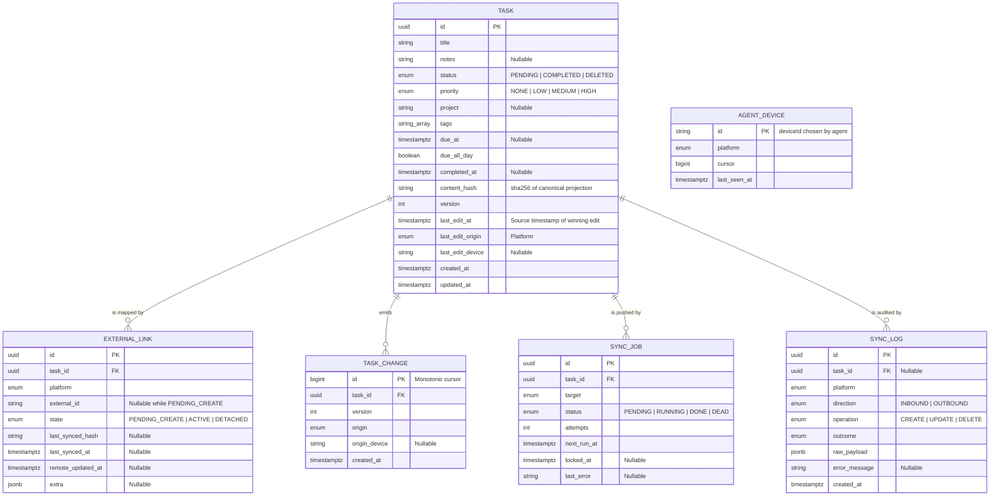

# Iris: Database Design

## Overview

**Database:** PostgreSQL 17 (Docker container, same Compose stack as the hub).
**ORM:** Prisma (latest major version). Raw SQL is used only for the constructs listed in [Constraints and invariants](#constraints-and-invariants).
**Objective:** Store one canonical record per task, map it to every platform's identifier, guarantee idempotent and loop-free sync, provide a durable outbound queue and an ordered change feed, and keep a complete audit trail.

**Design principles**

1. `Task` is the source of truth; platforms are projections of it (ADR-001, ADR-006).
2. External identity lives in `ExternalLink`, one row per task per platform (ADR-003).
3. Every canonical change is written in **one transaction** together with its `TaskChange`, `SyncLog` and `SyncJob` rows.
4. Nothing is hard-deleted, except `SyncLog` retention pruning and `DONE` jobs older than 7 days.

## Entity-relationship diagram



## Prisma schema

<!-- TODO: once spec 01 creates prisma/schema.prisma, replace this copy with a link to it (CONVENTIONS section 8: the schema file owns the columns). -->

```prisma
generator client {
  provider = "prisma-client"          // Prisma ≥ 7; use "prisma-client-js" on 6.x
  output   = "../src/generated/prisma"
}

datasource db {
  provider = "postgresql"             // URL provided via prisma.config.ts / DATABASE_URL
}

enum TaskStatus {
  PENDING
  COMPLETED
  DELETED
}

enum Priority {
  NONE
  LOW
  MEDIUM
  HIGH
}

enum Platform {
  TASKWARRIOR
  GOOGLE_TASKS
  GOOGLE_CALENDAR
  HABITICA
}

enum LinkState {
  PENDING_CREATE
  ACTIVE
  DETACHED
}

enum JobStatus {
  PENDING
  RUNNING
  DONE
  DEAD
}

enum SyncDirection {
  INBOUND
  OUTBOUND
}

enum SyncOperation {
  CREATE
  UPDATE
  DELETE
}

enum SyncOutcome {
  APPLIED
  NOOP_ECHO
  NOOP_DUPLICATE
  REJECTED_STALE
  REJECTED_INVALID
  IGNORED
  FAILED
}

model Task {
  id             String     @id @default(uuid()) @db.Uuid
  title          String
  notes          String?
  status         TaskStatus @default(PENDING)
  priority       Priority   @default(NONE)
  project        String?
  tags           String[]   @default([])
  dueAt          DateTime?  @map("due_at") @db.Timestamptz(3)
  dueAllDay      Boolean    @default(false) @map("due_all_day")
  completedAt    DateTime?  @map("completed_at") @db.Timestamptz(3)
  contentHash    String     @map("content_hash") @db.Char(64)
  version        Int        @default(1)
  lastEditAt     DateTime   @map("last_edit_at") @db.Timestamptz(3)
  lastEditOrigin Platform   @map("last_edit_origin")
  lastEditDevice String?    @map("last_edit_device")
  createdAt      DateTime   @default(now()) @map("created_at") @db.Timestamptz(3)
  updatedAt      DateTime   @updatedAt @map("updated_at") @db.Timestamptz(3)

  links   ExternalLink[]
  changes TaskChange[]
  jobs    SyncJob[]
  logs    SyncLog[]

  @@index([status])
  @@index([dueAt])
  @@index([updatedAt])
  @@map("tasks")
}

model ExternalLink {
  id              String    @id @default(uuid()) @db.Uuid
  taskId          String    @map("task_id") @db.Uuid
  platform        Platform
  externalId      String?   @map("external_id")
  state           LinkState @default(PENDING_CREATE)
  lastSyncedHash  String?   @map("last_synced_hash") @db.Char(64)
  lastSyncedAt    DateTime? @map("last_synced_at") @db.Timestamptz(3)
  remoteUpdatedAt DateTime? @map("remote_updated_at") @db.Timestamptz(3)
  extra           Json?
  createdAt       DateTime  @default(now()) @map("created_at") @db.Timestamptz(3)
  updatedAt       DateTime  @updatedAt @map("updated_at") @db.Timestamptz(3)

  task Task @relation(fields: [taskId], references: [id], onDelete: Cascade)

  @@unique([taskId, platform])
  @@unique([platform, externalId])
  @@index([platform, state])
  @@map("external_links")
}

model TaskChange {
  id           BigInt   @id @default(autoincrement())
  taskId       String   @map("task_id") @db.Uuid
  version      Int
  origin       Platform
  originDevice String?  @map("origin_device")
  createdAt    DateTime @default(now()) @map("created_at") @db.Timestamptz(3)

  task Task @relation(fields: [taskId], references: [id], onDelete: Cascade)

  @@index([taskId])
  @@map("task_changes")
}

model SyncJob {
  id        String    @id @default(uuid()) @db.Uuid
  taskId    String    @map("task_id") @db.Uuid
  target    Platform
  status    JobStatus @default(PENDING)
  attempts  Int       @default(0)
  nextRunAt DateTime  @default(now()) @map("next_run_at") @db.Timestamptz(3)
  lockedAt  DateTime? @map("locked_at") @db.Timestamptz(3)
  lastError String?   @map("last_error")
  createdAt DateTime  @default(now()) @map("created_at") @db.Timestamptz(3)
  updatedAt DateTime  @updatedAt @map("updated_at") @db.Timestamptz(3)

  task Task @relation(fields: [taskId], references: [id], onDelete: Cascade)

  @@index([status, nextRunAt])
  @@index([taskId])
  @@map("sync_jobs")
}

model SyncLog {
  id           String        @id @default(uuid()) @db.Uuid
  taskId       String?       @map("task_id") @db.Uuid
  platform     Platform
  direction    SyncDirection
  operation    SyncOperation
  outcome      SyncOutcome
  rawPayload   Json          @map("raw_payload")
  errorMessage String?       @map("error_message")
  createdAt    DateTime      @default(now()) @map("created_at") @db.Timestamptz(3)

  task Task? @relation(fields: [taskId], references: [id], onDelete: SetNull)

  @@index([taskId])
  @@index([createdAt])
  @@index([outcome])
  @@map("sync_logs")
}

model AgentDevice {
  id         String   @id
  platform   Platform
  cursor     BigInt   @default(0)
  lastSeenAt DateTime @default(now()) @map("last_seen_at") @db.Timestamptz(3)

  @@map("agent_devices")
}
```

## Entities

### `tasks`

- `title`: Non-empty after trim, ≤ 1024 chars (Google Tasks limit). Enforced in the domain layer.
- `tags`: Lowercased, deduplicated and sorted before storage, so hashes stay stable.
- `due_at` / `due_all_day`: If `due_all_day = true`, `due_at` must be `00:00:00.000Z` (ADR-014). `due_at IS NULL` implies `due_all_day = false`.
- `completed_at`: Set when the status becomes `COMPLETED` (from the source if provided, else `now()`); cleared otherwise.
- `content_hash`: `sha256(stableJson(project(CANONICAL, task)))`, recomputed on every write.
- `version`: +1 on every applied change. Never decremented.
- `last_edit_at`: The `sourceUpdatedAt` of the last applied inbound change, used by LWW (ADR-005).

### `external_links`

- `(task_id, platform)` unique: at most one link per platform per task.
- `(platform, external_id)` unique: Postgres treats NULLs as distinct, so several `PENDING_CREATE` links with a NULL ID may coexist.
- `state` transitions:
  - `PENDING_CREATE → ACTIVE` (remote create succeeded)
  - `ACTIVE → DETACHED` (remote deleted, or the task is no longer projectable, e.g. a calendar event without a due)
  - `DETACHED → PENDING_CREATE` (needs re-creation; `external_id` set to NULL)
- `last_synced_hash`: The hash of `project(platform, task)` at the last successful push or the last applied inbound change from this platform (ADR-004).
- `extra`: Platform-specific data. Keys used:
  - Habitica: `{ "completed": boolean }` (remote completion state, to decide on score up or down)
  - Calendar: `{ "etag": string }`
  - Taskwarrior: `{ "entry": string }` (original TW entry timestamp, kept on re-export)
- For `TASKWARRIOR` (agent platform), `external_id` is the TW UUID. When the change feed serves a task with no link for the agent platform, it creates one (`ACTIVE`, UUID v4) in the same transaction (ADR-008). Agent links never use `PENDING_CREATE` or `last_synced_hash`.

### `task_changes`

- Append-only, one row per applied canonical change (including creation).
- `id` is the agent cursor. Feed query: every task with a change `id > :since` whose `origin_device IS DISTINCT FROM :deviceId`, returning the current task state and `max(id)` as the new cursor.

### `sync_jobs`

- One `PENDING` job at most per `(task_id, target)` (partial unique index, see [Constraints and invariants](#constraints-and-invariants)).
- Only push targets appear here: `GOOGLE_TASKS`, `GOOGLE_CALENDAR`, `HABITICA`.
- Retry: `attempts += 1`, `next_run_at = now() + min(5s · 2^attempts, 1h)`. After 10 attempts, `status = DEAD`.
- `DONE` rows older than 7 days are deleted by the daily maintenance job.

### `sync_logs`

- One row per inbound change (every outcome) and per outbound attempt.
- `raw_payload`: the payload as received or sent, with secrets removed.
- Retention: 90 days, pruned daily.

### `agent_devices`

- Upserted on each feed request (`last_seen_at`, `cursor` = cursor returned). For observability only; the agent's local cursor is authoritative.

## Constraints and invariants

### Raw SQL (in migrations)

1. **Outbox coalescing:** at most one pending job per task and target.

   ```sql
   CREATE UNIQUE INDEX sync_jobs_pending_uniq
     ON sync_jobs (task_id, target) WHERE status = 'PENDING';
   ```

   Enqueue with `INSERT … ON CONFLICT (task_id, target) WHERE status = 'PENDING' DO UPDATE SET next_run_at = LEAST(sync_jobs.next_run_at, now())`.

2. **Due invariant:**

   ```sql
   ALTER TABLE tasks ADD CONSTRAINT tasks_due_all_day_chk
     CHECK (due_at IS NOT NULL OR due_all_day = false);
   ```

3. **Job claim (worker):**

   ```sql
   UPDATE sync_jobs SET status = 'RUNNING', locked_at = now()
   WHERE id IN (
     SELECT id FROM sync_jobs
     WHERE status = 'PENDING' AND next_run_at <= now()
     ORDER BY next_run_at
     LIMIT $1
     FOR UPDATE SKIP LOCKED)
   RETURNING *;
   ```

4. **Ingest serialization:** `SELECT pg_advisory_xact_lock(hashtextextended($platform || ':' || $externalId, 0))` at the start of each ingest transaction, then `SELECT … FROM tasks WHERE id = $1 FOR UPDATE` once the task is resolved.

## Indexes and performance

| Index | Purpose |
| --- | --- |
| `external_links (platform, external_id)` UNIQUE | Resolve inbound external IDs |
| `external_links (task_id, platform)` UNIQUE | Link lookup during dispatch |
| `external_links (platform, state)` | `PENDING_CREATE` adoption scan |
| `sync_jobs (status, next_run_at)` | Worker claim |
| `sync_jobs_pending_uniq` (partial) | Coalescing |
| `task_changes (id)` PK | Feed cursor range scan |
| `tasks (status)`, `tasks (due_at)`, `tasks (updated_at)` | Admin API filters |
| `sync_logs (created_at)` | Retention pruning |
